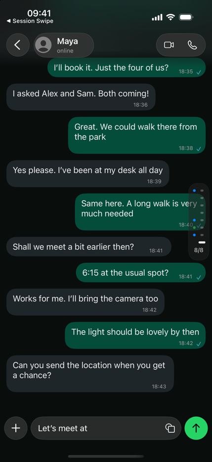
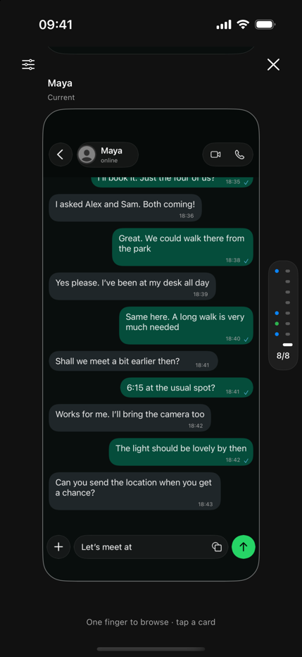
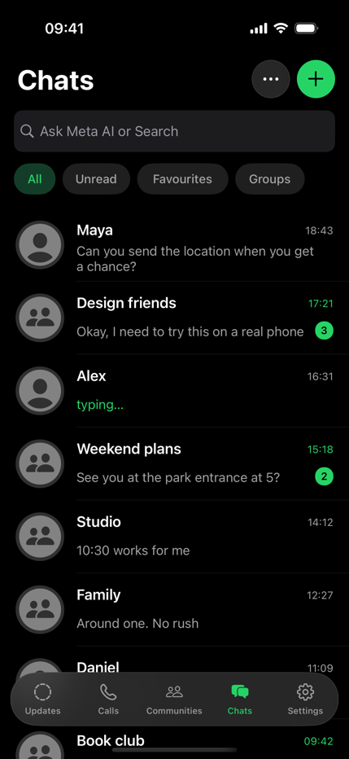

# Verification

Checked on 21 October 2026.

**Final result: passed for the scoped native interaction prototype.** This is not a claim of full WhatsApp functionality or physical multitouch validation.

## Direct evidence

- Both `SessionSwipe` and `WhatsAppSwipe` build for iOS Simulator.
- The WhatsApp target also builds for an iPhone and passes strict code-signature verification.
- The WhatsApp demo installed and launched normally on the connected iPhone after retrying a transient connection failure. This confirms launch, not physical gesture comfort.
- Both native model suites pass: history ordering and branching, direction mapping, release rules, state round trips, legacy settings migration, and the WhatsApp sample configuration.
- A focused scripted native smoke check passes **11 checks in each app**: indicator action, initial focus, eight cards, scrolling focus, card selection, full-screen settlement, gentle-release entry, live resizing, return to current chat, locally saved message, and controls presentation.
- The shared browser model’s eight checks pass, including spatial direction, overview release and rejected gesture entry.
- Simulator captures of the WhatsApp conversation, list and overview were opened and inspected. A private comparison sheet places the October source screenshot beside the native conversation capture.

## Visual scope

The inspected conversation matches the source’s app-owned arrangement: separate circular back control, compact contact capsule, grouped call buttons, soft navigation fade, rounded incoming/outgoing bubbles and floating composer controls. The list has working search and filters, sample typing/unread states, and a floating tab treatment. The added stack preserves the existing interaction and controls.

Intentional differences: fictional text replaces the source’s media messages; profile photos and branded wallpaper are replaced by generic contact avatars and a plain dark wallpaper. Native system symbols approximate secondary message metadata and sticker controls. The Simulator runs iOS 18.6, so its screenshots show the blur fallback; the iOS 26+ glass path is included in the signed build. The status bar and home indicator belong to iOS.

No blocking layout defects were found in the inspected states. The target is a familiar shell for judging a new interaction, rather than a pixel-identical implementation of every WhatsApp feature.

## Remaining hands-on checks

Physical three-finger recognition, release comfort and haptic feel need testing on an iPhone. The smoke check uses native control events, programmed collection scrolling and the real release path. It does not synthesize or prove physical three-finger input. The longer XCTest restoration suite was not rerun.

## Screenshots

| Conversation | Overview | Chat list |
| --- | --- | --- |
|  |  |  |

These are captures of the prototype with fictional data. Downloaded third-party reference screenshots and local device diagnostics are excluded from Git.

## Public website review

The Threefold landing page was inspected in the in-app browser at desktop and mobile sizes. Older/newer navigation, both appearances, opening the stack, selecting a card and the guided gesture were exercised. A real browser pointer drag showed the shrunken midpoint; a gentle release opened the overview. Sixteen native sample screens were captured from the reviewed simulator builds and inspected as a contact sheet. The website states that its one-finger/mouse sketch does not establish native three-finger or haptic behavior.

The landing page also passed 320 px and 390 px overflow/image checks. All preview images loaded. Desktop primary actions were visible at the tested 1280 × 900 viewport.

The `ThreeFingerGesture` unit checks cover the earlier editable study. The published sketch intentionally uses a separate one-pointer handler, with the shared history/direction/release decisions. Its drag and gentle release were tested through browser input. A review finding about focus entering the overview was corrected by focusing the current card on entry and returning focus to the enabled trigger on close.

Final keyboard checks exercised both stack entry controls, Escape, the close control, and switching appearance while the overview was open. Focus entered the current card, returned to Browse or Watch on ordinary close, and stayed on the selected appearance after a mode change.
